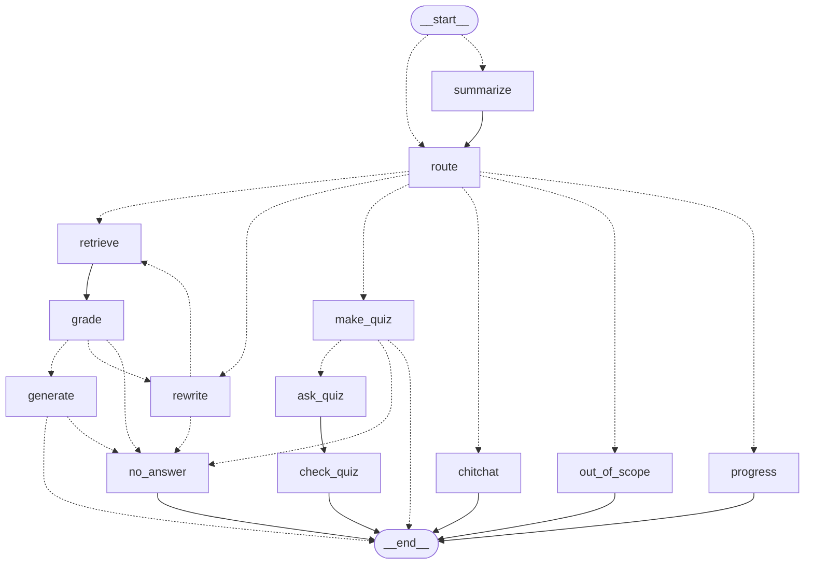

# Ассистент по учебным материалам — агент на LangGraph поверх гибридного RAG

Студент загружает лекции, ассистент:

- отвечает на вопросы **только по ним**, со ссылкой `[файл, стр. N]`, которая открывает PDF на этой странице;
- честно говорит «в материалах этого нет» и подсказывает ближайшие темы, если ответа нет;
- составляет тест из 5 вопросов по теме, проверяет ответы и запоминает темы, в которых студент ошибся;
- помнит контекст диалога («а закон Кулона?» после вопроса про Гаусса) и сжимает длинную историю;
- доступен через веб-интерфейс, HTTP API со стримингом (SSE) и командную строку.

Стек: Python 3.12, **LangGraph 1.2** (StateGraph, `Command`, `interrupt`, checkpointer, Store),
Qdrant (dense + BM25, RRF), BAAI/bge-m3, bge-reranker-v2-m3, FastAPI + SSE, Streamlit,
LLM через цепочку адаптеров — **GigaChat** (SDK со своим OAuth) и любой OpenAI-совместимый API
(внешний провайдер / Ollama / vLLM) с fallback между ними, Docker Compose, pytest.

Почему сделано именно так — в [DECISIONS.md](DECISIONS.md): там ответы на «почему граф, а не
цепочка», «что дал реранкер в цифрах», «как устроена память» и другие вопросы.

## Граф агента

Схема сгенерирована из кода (`python -m app.cli graph`), пунктир — условные переходы:



| Узел | Что делает | LLM |
|---|---|---|
| `summarize` | сжимает старую часть диалога, когда история длиннее порога | да, редко |
| `route` | вопрос / тест / болтовня / не по теме / «что повторить» — сначала регулярки | только если правила не уверены |
| `retrieve` | гибридный поиск dense + BM25 (RRF в Qdrant) → реранкер → top-5 | нет |
| `grade` | хватает ли найденного: порог по скору реранкера | только в серой зоне |
| `rewrite` | переписывает запрос с учётом истории; не больше `MAX_REWRITES` раз | да |
| `generate` | ответ только по фрагментам, стрим токенов, цитаты `[файл, стр. N]` | да |
| `no_answer` | «в материалах этого нет» + ближайшие темы | нет |
| `make_quiz` → `ask_quiz` → `check_quiz` | тест: генерация по схеме, `interrupt` до ответов, проверка, запись слабых тем в Store | да, один раз |
| `chitchat`, `out_of_scope`, `progress` | шаблоны и слабые темы из Store | только для болтовни вне шаблонов |

Память: история диалога — в checkpointer (SQLite, `thread_id`), слабые темы — в LangGraph Store
по `user_id` (видны во всех диалогах). При любом сбое LLM граф деградирует мягко: например,
если модель недоступна, ответ — список мест в материалах, где это есть.

## Метрики

**Только измеренное.** Golden set — [`eval/golden_set.jsonl`](eval/golden_set.jsonl): 50 вопросов
по 9 лекциям курса физики «Электричество и магнетизм» (137 страниц, 184 чанка) с эталонными
страницами и ответами, плюс 8 вопросов, ответа на которые в лекциях нет. CPU Intel Core Ultra 5 225H, без GPU.

### Поиск — [`eval/retrieval_eval.py`](eval/retrieval_eval.py)

| Конфигурация | hit@1 | recall@5 | MRR@10 | задержка p50 / p95 |
|---|---|---|---|---|
| dense (bge-m3) | 0,92 | 1,00 | 0,957 | 0,11 / 0,13 с |
| hybrid (dense + BM25, RRF) | 0,94 | 1,00 | 0,970 | 0,11 / 0,14 с |
| dense + реранкер | 0,98 | 1,00 | 0,987 | 4,65 / 5,62 с |
| **hybrid + реранкер** (по умолчанию) | **0,98** | **1,00** | **0,987** | 4,51 / 5,30 с |

recall@5 = 1,00 у всех: корпус маленький, правильная страница всегда в top-5. Разница — в том,
*какой* фрагмент первый (hit@1, MRR), и в том, можно ли по скору понять «ответа нет»:

| | худший скор вопроса с ответом | лучший скор вопроса без ответа |
|---|---|---|
| косинус dense | 0,602 | 0,593 — перекрываются, порог не поставить |
| реранкер | 0,688 | 0,315 — чистый зазор, порог 0,5 |

С порогом 0,5 все 50 вопросов с ответом проходят без лишнего вызова LLM, 6 из 8 вопросов без
ответа отсекаются до генерации, 2 уходят в серую зону к LLM-грейдеру. Порог подобран на этом же
наборе — это калибровка, не доказательство. Полная таблица — [`eval/results/retrieval.md`](eval/results/retrieval.md).

### Ответы агента — [`eval/agent_eval.py`](eval/agent_eval.py)

Граф целиком на тех же 58 вопросах, LLM — GigaChat-3-Ultra (ответил на все 58, fallback не понадобился),
судья корректности и faithfulness — та же модель с отдельным промптом.

| Метрика | Значение |
|---|---|
| Ответил на вопросы, где ответ есть | 50 из 50 |
| Цитата указывает на эталонную страницу | 50 из 50 |
| Корректно / опирается только на источники (судья) | 50 из 50 / 50 из 50 |
| Честный отказ на вопросах без ответа | 8 из 8 |
| Задержка ответа p50 / p95 | 6,7 с / 19,1 с |
| Вызовов LLM на вопрос | 1,22 |
| Токенов на вопрос, вход / выход (токенизатор GigaChat) | 863 / 44 |

Как это читать — без иллюзий:

- **Набор лёгкий.** Вопросы на определения, составлены по тем же слайдам; поиск уже даёт
  recall@5 = 1,00. 100% здесь значит «пайплайн не ломает то, что нашёл поиск», а не «модель
  всегда права». Нужны вопросы сложнее: на сравнение разделов, на задачи с формулами.
- **Судья — та же модель**, что отвечает, а самооценка снисходительна. Поэтому 10 случайных ответов
  и оба «трудных» отказа я проверил вручную: все верны. Нашёлся один реальный изъян — «выражается
  формулой, где R — …»: формулы MathType при извлечении текста из PDF теряются, и модель честно
  ссылается на формулу, которой во фрагменте нет.
- **p95 = 19 с — это отказы:** на вопрос без ответа граф дважды переписывает запрос и трижды ищет
  (с реранком по 4,5 с на CPU). На вопросах с ответом задержка 5,4–9,9 с, из них ~4,5 с — реранкер.
- Два вопроса без ответа дошли до генерации (серая зона реранкера), и там модель сама ответила
  «в материалах этого нет» — сработала вторая линия защиты. Подробно — [`eval/results/agent.md`](eval/results/agent.md).

### Выбор LLM — [`eval/llm_shootout.py`](eval/llm_shootout.py)

Основная модель — **GigaChat-3-Ultra**: личный тариф даёт десятки миллионов токенов и не требует
ручных отметок. Запасные — бесплатные модели внешнего OpenAI-совместимого провайдера: пять из них
сравнены на одних и тех же фрагментах (все 6/6 — ответ с цитатой, честный отказ, устойчивость к
инъекции; задержка 2,3–2,5 с), в цепочке glm-5.3-flash и gpt-6-luna. Подробно — в DECISIONS.md.

## Запуск в Docker

```bash
git clone https://github.com/pogl2007/langGraph_studyAssistant.git && cd langGraph_studyAssistant
cp .env.example .env        # GIGACHAT_CREDENTIALS и/или LLM_API_KEY, или указать Ollama
docker compose up -d --build
```

- интерфейс — http://localhost:8501
- API и Swagger — http://localhost:8000/docs
- Qdrant — http://localhost:6333/dashboard

При первом запуске API скачивает модели (~5 ГБ: bge-m3, BM25, реранкер) в volume `hf_models`,
healthcheck ждёт до 10 минут. Локальная LLM вместо внешнего API:
`docker compose --profile ollama up -d` и `LLM_BASE_URL=http://ollama:11434/v1` в `.env`.

## Локальная разработка

```bash
docker compose up -d qdrant
python -m venv .venv && .venv/Scripts/pip install -e ".[dev]"
.venv/Scripts/python -m app.cli index "путь/к/лекциям" --course physics
.venv/Scripts/uvicorn app.api.main:app --port 8000
.venv/Scripts/streamlit run ui/streamlit_app.py
```

Командная строка без API и интерфейса:

```bash
python -m app.cli search "теорема Гаусса" --course physics            # отладка поиска со скорами
python -m app.cli search "теорема Гаусса" --mode dense --no-rerank    # то же без гибрида и реранкера
python -m app.cli ask "Что утверждает теорема Гаусса?" --course physics  # агент целиком, стрим в терминал
python -m app.cli graph                                              # схема графа в Mermaid
```

## API

| Метод | Путь | Что делает |
|---|---|---|
| POST | `/documents` | загрузка PDF → `202` и `task_id`, индексация в фоне |
| GET | `/documents/tasks/{task_id}` | статус: queued / running / done / failed |
| GET | `/documents?course=` | список файлов |
| GET | `/documents/{file_id}/file` | сам PDF — цитаты ссылаются на `…/file#page=N` |
| DELETE | `/documents/{file_id}` | удалить файл и его чанки |
| POST | `/chat` | ответ агента потоком SSE |
| POST | `/chat/resume` | ответы на тест — продолжение графа после `interrupt` |
| POST | `/feedback` | 👍 / 👎 на ответ |
| GET | `/health` | Qdrant доступен, коллекция есть |

События `/chat`: `status` и `node` (ход графа), `route`, `grade` (со скором реранкера),
`rewrite` (новый запрос), `token`, `quiz` (вопросы без правильных ответов), `answer`
(текст и цитаты со ссылками), `error`, `done`. У каждого ответа заголовок `x-request-id`,
логи — JSON с тем же `request_id`.

## Тесты

```bash
.venv/Scripts/python -m pytest      # 95 тестов, ~6 с, без сети и без моделей
```

- граф с замоканной LLM и настоящим поиском по маленькому набору документов: вопрос → ответ с
  цитатой; нерелевантное → rewrite → отказ; лимит переписываний; отсылка к истории; серая зона
  грейдера; отказ модели; недоступная LLM; тест с `interrupt` и `Command(resume=...)`;
  слабые темы между диалогами; пакетная суммаризация;
- адаптер GigaChat на подменном клиенте SDK: 429 с `Retry-After` и без, 401 → запасной провайдер,
  5xx и таймаут с задержкой, стрим, порядок `LLM_CHAIN`, баг в нашем коде не прячется за fallback;
- слой LLM на `httpx.MockTransport`: 429 с коротким и длинным `Retry-After`, 402, 5xx, пустой
  ответ, стрим с fallback до первого токена, починка JSON;
- API: загрузка и её безопасность (расширение, размер, сигнатура, path traversal), статус задачи,
  SSE-чат, тест через resume, обратная связь;
- парсинг слайдов, структурный чанкинг, гибридный поиск, реранкер, имена файлов в NFD.

Qdrant в тестах — встроенный в память, эмбеддинги и реранкер — детерминированные заглушки.

## Структура

```
app/
  graph/       состояние, узлы, правила маршрутизации, промпты, память, сборка графа
  retrieval/   эмбеддинги, BM25, реранкер, Qdrant, поиск
  ingest/      парсинг PDF со структурой, чанкинг, индексация
  answer/      промпт ответа, цитаты, линейный RAG (точка отсчёта)
  llm/         адаптеры OpenAI-совместимого API и GigaChat, fallback, ретраи, стриминг, JSON по схеме
  api/         FastAPI: документы, SSE-чат, фоновые задачи, request_id
  cli.py       индексация, поиск, вопрос агенту, схема графа
ui/            Streamlit — тонкий клиент к API
eval/          golden set, оценка поиска и агента, сравнение LLM, результаты
tests/
```

## Ограничения и что дальше

- **MCP-сервера здесь нет** — следующий шаг: `search_materials` и `ask` поверх того же графа,
  FastMCP в FastAPI через `http_app()` (MCP есть в другом моём проекте, career-mcp).
- **OCR сканов** не сделан: сейчас только PDF с текстовым слоем.
- **Реранкер на CPU — 4,5 с** на запрос; на GPU — доли секунды.
- **Формулы из слайдов теряются** при извлечении текста — нужен OCR формул или LaTeX-источник лекций.
- Golden set маленький, лёгкий и составлен по тем же лекциям, на которых подбирался порог.
- TLS для GigaChat: правильно — указать корневой сертификат Минцифры (`GIGACHAT_CA_BUNDLE`);
  `GIGACHAT_VERIFY_SSL=false` — только для локальной разработки.
